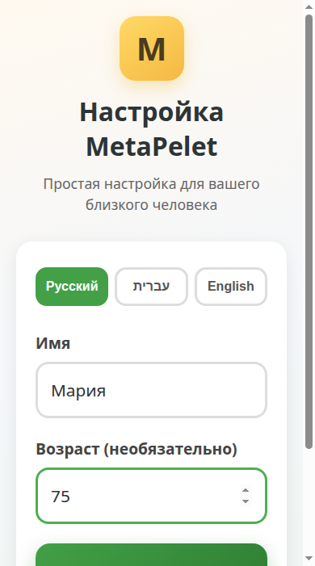
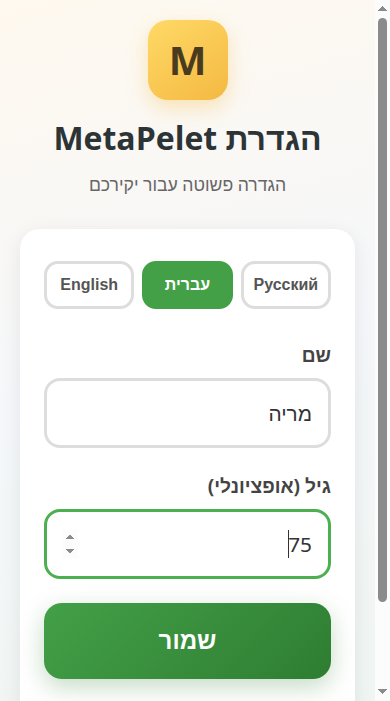
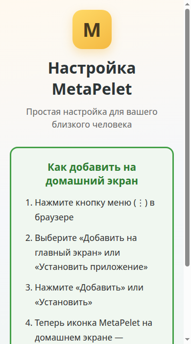
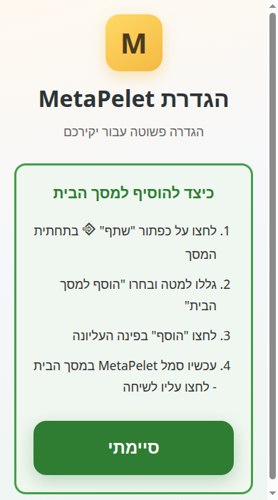
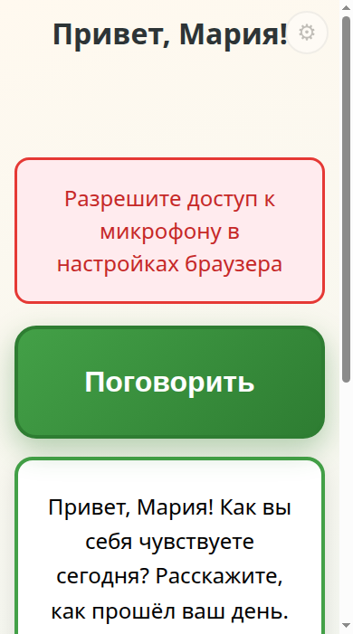
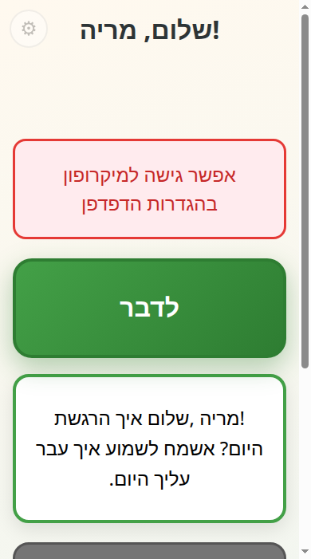

# MetaPelet PWA: Elder-Friendly One-Tap Access

## 🎯 Goal Achieved
Elderly people can now use MetaPelet with **ONE tap** from their phone home screen after a simple one-time setup.

---

## 📱 User Journey

### Step 1: Relative Opens Setup (Once)
The relative opens `https://www.metapelet.org/setup` and fills in basic info:

**Russian Setup:**


**Hebrew Setup (RTL):**


---

### Step 2: Add to Home Screen Instructions

**Android (Chrome):**


**iPhone (Safari):**


---

### Step 3: Elder Taps Icon → Direct Conversation

After setup, tapping the home-screen icon goes straight to conversation:

**Russian Interface:**


**Hebrew Interface (RTL):**


---

## ✨ Elder-Friendly Features

### 🔤 **Very Large Text**
- Greeting: **2.5rem** (40px+)
- Talk button: **2.5rem** with **48px padding**
- Status messages: **1.8rem** (29px+)
- Reply text: **1.8rem** with high line-height

### 🎨 **High Contrast**
- Talk button: Bright green (`#43a047`) with white text
- Stop button: Bright red (`#e53935`) with white text
- Black text (`#000`) on white backgrounds
- Clear borders: **4px solid** for visibility

### 👆 **Large Tap Targets**
- Talk button: **Full width**, 96px+ height
- All buttons: Minimum 48px touch target
- Generous padding and spacing

### 🌐 **Full Language Support**
- **Russian** (Русский) - LTR layout
- **Hebrew** (עברית) - RTL layout with proper right-alignment
- **English** - LTR layout

### 🛡️ **Accidental-Tap Protection**
- Settings gear icon requires **2-second long-press**
- Small, semi-transparent (40% opacity)
- Elder won't accidentally change settings

### 📶 **Clear Error Handling**
- Microphone unavailable? Large friendly message
- Network error? "No connection to server" + retry button
- All errors in elder's language

---

## 🧪 Technical Quality

### ✅ All Tests Pass
```
Ran 72 tests in 0.032s
OK

55 existing tests (maintained)
+ 17 new PWA tests
= 72 total tests passing
```

### 📦 What Was Added
1. **Setup page** (`/setup`) - Simple one-time configuration
2. **Talk page** (`/talk`) - Elder-friendly conversation UI
3. **PWA manifest** - Installability and home-screen icon
4. **Service worker** - Minimal, network-first, no API caching
5. **Icons** - 192x192, 512x512, apple-touch-icon
6. **Tests** - Full coverage of new features

### 🔒 What Was NOT Changed
- Budget guard limits (unchanged)
- Pilot tracking (unchanged)
- Health endpoint (unchanged)
- Database code (unchanged)
- Protected admin endpoints (unchanged)
- Existing `/chat` and `/tts` APIs (unchanged)

---

## 📊 Results

### Before This PR:
1. Elder opens browser
2. Navigates to website
3. Selects language
4. Fills form
5. Taps "Try for free"
6. Fills questionnaire
7. Finally starts talking

❌ **7 steps, multiple taps, easy to get lost**

### After This PR:
1. ✅ **Tap home-screen icon**
2. ✅ **Start talking**

✅ **ONE tap, direct to conversation**

---

## 🚀 How to Deploy

1. Merge this PR to `main`
2. Render will auto-deploy
3. Share `https://www.metapelet.org/setup` with relatives
4. They set up once, elder uses forever

---

## 📝 Notes

- Profile stored in **localStorage only** (no new server data)
- Works offline after first visit (service worker caches `/talk` only)
- Browser autoplay policy respected (shows "Talk" button if needed)
- Microphone permission handled gracefully
- Works on Android Chrome, iPhone Safari, and modern browsers

---

**Ready to make MetaPelet truly accessible to elderly users! 🎉**
